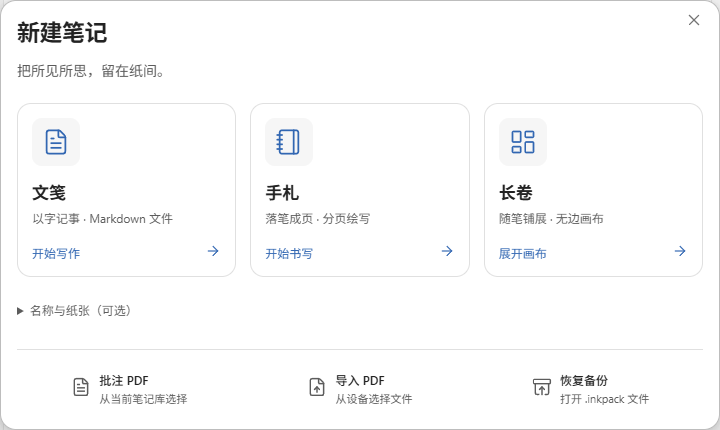

# 页墨手记 PageInk

**文笺记事，手札留痕，长卷展意。**

在 Obsidian 中写文字、逐页绘写、展开无边画布，也能批注 PDF，用独立草稿纸演算和摘录。

Write Markdown notes, annotate PDFs, and draw on paginated pages or an infinite canvas, with a separate scratchpad. The interface is in Simplified Chinese.

## 三种记录方式

| 类型 | 用途 |
| --- | --- |
| **文笺** | 普通 Markdown `.md` 文件，使用 Obsidian 原生编辑器。 |
| **手札** | 分页书写和绘画，支持翻页、纸张模板与页边距。 |
| **长卷** | 无边画布，用文字、笔迹和卡片展开想法。 |

- **PDF 批注**：在教材和文档上书写，摘录内容到草稿纸。
- **文字与手写互通**：在文笺中引用手写区域，或把文字段落放进手札和长卷。
- **统一笔记库**：按类型浏览，搜索名称和正文，一键打开今日记录。
- **导出与备份**：导出 PDF、PNG，或保存可恢复编辑的完整备份。

## 安装

需要 **Obsidian 1.12.7 或更高版本**。当前已在 Windows 验证；移动端尚未完成真机验证。

1. 从 [Releases](https://github.com/ZZZdragondYNGPHX/pageink/releases/latest) 下载 `pageink-0.1.3.zip`。
2. 解压，将 `pageink` 文件夹放入笔记库的 `.obsidian/plugins/`。
3. 重启 Obsidian，在「设置 → 第三方插件」中启用「PageInk」。
4. 点击侧边栏的笔记本图标，打开笔记库。

也可将同一版本的 `main.js`、`manifest.json` 和 `styles.css` 放入 `.obsidian/plugins/pageink/`。社区目录收录前，请使用上述手动安装方式。

## 开始使用

在笔记库点击「文笺」「手札」或「长卷」即可开始。「新建与导入」还可选择名称、纸张、PDF 或备份文件。

笔记自动保存在本地。绘写文档的完整备份请使用「导出 → 可编辑备份」；单独复制 `.inknote` 文件不包含笔迹和附件。多设备使用时，等待同步工具完成传输后再切换设备。

[使用指南](docs/guide.md) · [更新记录](CHANGELOG.md) · [反馈问题](https://github.com/ZZZdragondYNGPHX/pageink/issues)

## 离线与隐私

PageInk 免费、开源，无账号要求、无广告、无遥测，不发起运行时网络请求。字体、PDF 处理和解码资源随插件提供，因此主脚本约 46 MB。

仅在你主动选择导入 PDF、图片或备份文件时读取所选库外文件，并将所需内容复制入库。

## 开发与许可

构建和源码说明见[开发指南](docs/development.md)。

自有代码采用 [MIT 许可证](LICENSE)。绘图内核使用 Excalidraw，图标使用 Lucide；第三方代码、字体及资源保留各自许可，详见[第三方声明](THIRD_PARTY_NOTICES.md)。
