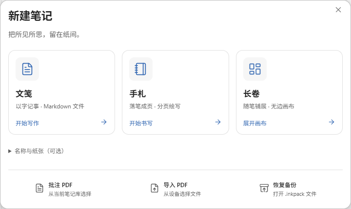

# 页墨手记 PageInk

Obsidian 插件，支持 Markdown、分页手写、无边画布、PDF 批注和独立草稿纸。界面使用简体中文。

## 功能

| 类型 | 功能 |
| --- | --- |
| 文字笔记 | 原生 Markdown 编辑、属性、`![[笔记.inknote]]` 嵌入和手写引用。 |
| 手写笔记 | 分页绘写、纸张模板、页边距、区域书签。 |
| 无边画布 | 文字、笔迹和来源卡片，支持分组与连线。 |
| PDF 批注 | 书写、文字搜索、原文复制和摘录。 |
| 草稿纸 | 与正文独立的内容、视口和撤销历史，支持停靠与浮动。 |

文件夹浏览提供内容预览和搜索。绘写可导出 PDF、PNG 或完整可编辑备份。

## 安装

需要 Obsidian **1.12.7+**。在「设置 → 第三方插件 → 浏览」中搜索 **PageInk**，安装并启用。更新使用第三方插件设置中的「检查更新」。

手动安装：从 [Releases](https://github.com/ZZZdragondYNGPHX/pageink/releases/latest) 下载安装 ZIP，将 `pageink` 文件夹解压至笔记库的 `.obsidian/plugins/`，重新启用插件。也可下载 `main.js`、`manifest.json` 和 `styles.css`，放入 `.obsidian/plugins/pageink/`。

## 使用

文件列表保留原生「新建笔记」，点击独立的「新建绘写笔记」按钮（或文件夹右键菜单、设置页可选的左侧功能区按钮）创建手写笔记、无边画布，或打开「纸张设置与导入」导入 PDF 和备份。插件设置页可配置默认纸张（新装默认横线纸）、新建目录、导出目录与嵌入宽度。「以缩略图浏览」打开当前文件夹的内容预览。

文字笔记由 Obsidian 保存。绘写自动保存到库内；「导出 → 可编辑备份」生成包含笔迹、草稿纸和附件的 `.inkpack`。

[使用指南](docs/guide.md) · [开发指南](docs/development.md) · [更新记录](CHANGELOG.md) · [插件目录](https://community.obsidian.md/plugins/pageink) · [问题反馈](https://github.com/ZZZdragondYNGPHX/pageink/issues)

## 运行与数据

PageInk 离线运行，无账号、广告或遥测。字体与 PDF 资源内嵌在约 46 MB 的主脚本中。Obsidian Sync Standard 的单文件上限为 5 MB，使用该方案时需在各设备分别安装插件。

绘写文档由 `.inknote` 入口、`Drawing Resources/` 和关联 PDF 组成。迁移使用 `.inkpack` 或同步整个库；多设备编辑需等待资源传输完成。保存周期、冲突恢复及设备支持见[使用指南](docs/guide.md)。

## Installation and usage

PageInk supports Markdown notes, paginated handwriting, an infinite canvas, PDF annotations, and a separate scratchpad. It requires Obsidian **1.12.7+** and uses a Simplified Chinese interface.

1. Search for **PageInk** in **Settings → Community plugins → Browse**, then install and enable it. For manual installation, extract the ZIP from [Releases](https://github.com/ZZZdragondYNGPHX/pageink/releases/latest) into `.obsidian/plugins/`.
2. The file explorer keeps Obsidian's native **New note** button and adds a separate **新建绘写笔记** button (plus folder context menu and an optional ribbon icon in settings) to create paginated handwriting (**手写笔记**), an infinite canvas (**无边画布**), or import PDFs and backups (**纸张设置与导入**). Plugin settings configure the default paper (lined for new installs), note/export folders, and embed width.
3. Choose **导出 → 可编辑备份** for a complete `.inkpack` backup. Drawing data includes the `.inknote` file, vault resources, and the source PDF.

PageInk runs offline with bundled fonts and PDF resources. Its approximately 46 MB main script exceeds Obsidian Sync Standard's 5 MB file limit; install it separately on each device with that plan.

## 许可

自有代码采用 [MIT](LICENSE)。Excalidraw、Lucide、字体及其他依赖的许可见[第三方声明](THIRD_PARTY_NOTICES.md)，PDF 解码器来源与哈希见 [PDF runtime assets](docs/pdf-assets.md)。
