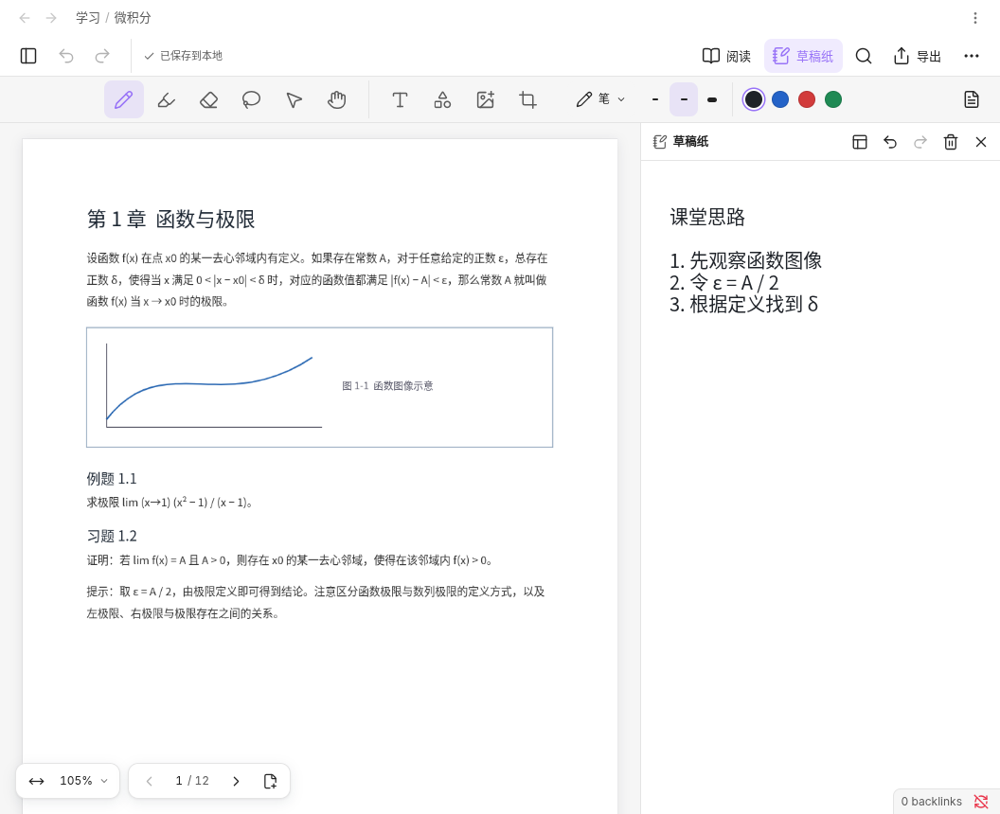

# 使用指南

[首页](../README.md) · [开发指南](development.md)

## 文件与搜索

文件列表的新建菜单和文件夹右键菜单提供「文字笔记」「手写笔记」「无边画布」。「纸张设置与导入」设置名称、纸张，或导入 PDF 与 `.inkpack`。

「以缩略图浏览」显示当前文件夹的内容预览，支持列表切换、类型筛选、重命名、删除及分屏打开。文件操作和标签页沿用 Obsidian。

文件夹搜索默认包含子文件夹，检索名称、路径、正文、属性、画布文字、书签和 PDF 文本。「搜索选项」可改为全库或仅名称；多个关键词需在同一笔记中全部匹配。手写、扫描件、图片和草稿纸不参与文字搜索。大 PDF 的首次索引可取消。

「快速打开」调用原生快速切换。「打开今日记录」使用日记插件；未启用时在当前新建位置创建日期笔记，并兼容 `PageInk Daily/YYYY-MM-DD.md`。

## 文字与绘写

文字笔记是原生 `.md` 文件。绘写中的区域书签可通过编辑器菜单或「插入手写区域」命令引用到 Markdown；阅读模式显示预览，点击标题返回来源。

手写笔记支持空白、横线、方格和点阵纸张。侧栏管理页面、书签和搜索；底部页码切换页面，页面菜单添加、复制、排序、删除或调整纸张。阅读模式收起编辑工具。

无边画布使用「移动」、空格拖动或滚轮导航，左下控件负责缩放、全览和视野书签。

| 操作 | 入口 |
| --- | --- |
| 书写和绘制 | 笔、荧光笔、文字、形状、图片。再次点击当前工具打开设置。 |
| 擦除 | 橡皮擦支持局部擦和整笔擦；笔在目标上快速折返两次、形成至少三段涂划，可擦除覆盖笔迹。笔设置可关闭涂划擦除。 |
| 编辑对象 | 圈选或选择后移动、缩放、复制、改色、加书签、导出或删除。 |
| 移动笔盒 | 拖动左侧柄；左右停靠竖排，顶部和底部横排。方向键移动，Home 复位，Escape 取消拖动。 |
| 收起笔盒 | 空闲约 8 秒收成笔按钮；点击展开。拖动、键盘操作和设置打开时保持展开。 |
| 手指用途 | 默认移动与缩放，「更多 → 用手指书写」切换为绘制。 |

涂划未命中时作为笔迹保存；普通圈线、折线和锁定对象保留。正文和草稿纸各保留最近 100 个撤销操作，应用重启后清空。

设备压感需支持压力的输入设备。Apple Pencil 双击和 Pencil Pro 轻捏依赖宿主原生事件接口，当前使用屏幕工具栏切换工具；接口状态见[宿主请求](https://forum.obsidian.md/t/expose-apple-pencil-double-tap-native-pencil-interactions-to-mobile-plugins/118705)。移动端支持状态为待实机验证。

## PDF 与草稿纸

「批注 PDF」打开库内文件；「导入 PDF」将设备文件复制入库。批注支持文字搜索、原文复制和页边距。「摘录」将框选内容放入草稿纸，摘录设置控制是否包含笔迹；选中后点击「出处」返回来源。

草稿纸默认停靠在正文右侧，窄窗口上下排列。标题栏切换停靠或浮动；浮动时拖动标题栏移动，左下角调整大小，两者都支持方向键。草稿纸拥有独立缩放与位置记忆，左下全览控件可显示全部内容。

选中内容后「复制到当前页」或「复制到画布」创建独立副本。切换布局和收起窗口保留内容；清空可撤销。

## 段落与卡片

在绘写工具栏选择「文字段落 → 插入文字段落」，选择 Markdown 来源和段落。段落面板可绑定所选笔迹、编辑原文、刷新、排序或移除。绑定笔迹随段落移动；移除段落保留笔迹。正文重新换行后可调整批注位置。

无边画布的「画布卡片」插入文字卡片或区域书签生成的手写卡片：

- 双击文字卡片编辑原文，Ctrl/⌘ + Enter 保存。
- 双击手写卡片打开来源，编辑后使用「更新卡片」。
- 选择两张卡片连接，选择多个对象组合移动。
- 「恢复引用时的原件」从来源快照另存可编辑副本。

文字引用以纯文本显示段落或标题；列表、表格、代码与富文本使用原生编辑器。手写卡片显示图片预览，备份保留原始笔迹。Markdown 编辑与绘写使用独立撤销历史。

## 属性

文字笔记使用原生属性。绘写通过文件菜单、「更多 → 笔记属性」或「编辑笔记属性」命令编辑文本、数字、布尔值和文字列表，复杂属性只读。原 PDF 不提供属性编辑。

提交只更新修改的键。并发修改同一属性时保留草稿并显示冲突。属性使用再次编辑修改，独立于画布撤销。

## 导出与备份

| 格式 | 内容 |
| --- | --- |
| PDF | 原 PDF、文字、笔迹、图片及页边距；支持全部或当前页。 |
| PNG | 当前页、画布或选区；画布和选区为透明背景。 |
| `.inkpack` | 完整笔记、草稿纸、附件、来源 PDF、引用文字快照和手写卡片备份。 |

输出至库内 `Drawing Exports/`，同名自动编号。PDF 和备份导出可取消；PDF 不含草稿纸。

「纸张设置与导入 → 恢复备份」将 `.inkpack` 另存为新笔记与独立资源，文字快照恢复为 `.md`。Markdown 链接指向的其他笔记和附件属于全库备份范围。

## 保存与恢复

| 内容 | 保存时机 |
| --- | --- |
| Markdown | Obsidian 原生保存。 |
| 绘写 | 停笔 3 分钟合并保存；持续书写每 15 分钟在抬笔时保存。 |
| 即时保存 | 关闭笔记、切后台或 Ctrl/⌘ + S。 |

撤销记录即时进入内存。异常退出会丢失尚未落盘的内容，保存状态显示本机写入结果。保存失败时可重试；标签页重开仍保留会话中的待保存内容。

迁移使用 `.inkpack` 或同步整个库，包括 `.inknote`、`Drawing Resources/` 和关联 PDF。多设备轮流编辑并等待同步完成。并发冲突可打开外部版本或继续编辑本地副本。

「历史版本」提供最近 20 份保存记录，恢复时另存笔记；入口损坏可使用「查看可恢复的版本」。这些记录使用库内资源。「重新关联原 PDF」修复丢失的来源，改版 PDF 使用新的批注笔记。

## 更新与反馈

社区目录通过「检查更新」安装新版；手动安装覆盖 `.obsidian/plugins/pageink/` 中的安装文件并重新启用。卸载保留库内笔记，绘写编辑需要 PageInk，PDF 可供其他应用阅读。

问题反馈使用 [Issues](https://github.com/ZZZdragondYNGPHX/pageink/issues)，附插件版本、Obsidian 版本、系统和复现步骤。大型 PDF 的加载、渲染和导出受设备资源影响；特殊 JPEG 2000 图片可能存在解码兼容问题。
