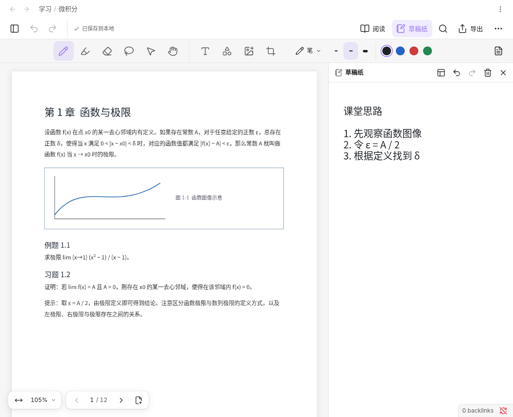

# 使用指南

[返回首页](../README.md)

## 文件与文件夹

在 Obsidian 文件列表顶部点击「新建笔记」，或右键文件夹，选择「文字笔记」「手写笔记」或「无边画布」，直接在当前文件夹开始记录。「纸张设置与导入」可指定名称、纸张、PDF 或备份文件。已有文件名不变。

文件列表顶部的「以缩略图浏览」显示当前文件夹的内容预览；也可右键文件夹选择该操作。文件树、路径导航和子文件夹使用同一套库内路径。可切换缩略图或列表，按类型筛选，右键文件重命名、删除、在新标签页或右侧打开。标签页、分屏、文件移动和普通文字编辑沿用 Obsidian。

文件夹搜索包含子文件夹，覆盖名称、路径、正文、属性、画布文字、书签和 PDF 文本；「搜索选项」可切换为整个库或仅搜索名称。命令「搜索笔记内容（含绘写与 PDF）」直接打开整个库的内容搜索。多个关键词需在同一份笔记中全部出现。点击结果跳到匹配位置。

搜索暂不识别手写笔迹、扫描件和图片中的文字，也不检索草稿纸、历史版本或卡片内的备份。大 PDF 首次搜索可能需要较长时间，可随时停止。

「快速打开」使用 Obsidian 快速切换；核心插件关闭时仍有文件选择入口。「打开今日记录」优先使用 Obsidian 日记及其配置；未启用日记时，在当前新建位置创建日期笔记，并继续兼容已有 `PageInk Daily/YYYY-MM-DD.md`。

## 文字笔记

文字笔记是普通 `.md` 文件，使用 Obsidian 原生编辑器，支持原生链接、属性、撤销和阅读模式。关闭 PageInk 后仍可编辑文字。

在手写笔记、无边画布或 PDF 批注中圈选一处内容并「加书签」，再回到文字笔记，通过编辑器右键菜单或命令面板选择「插入手写区域」，选择来源与书签。阅读模式会显示区域预览，点击标题返回来源；预览随来源保存更新。

## 手写笔记与无边画布

手写笔记用于分页绘写。点击「显示侧栏」打开左侧缩略图，也可用底部页码切换页面；页面菜单可添加、复制、排序、删除页面，或调整纸张与页边距。支持空白、横线、方格和点阵纸张。右上「阅读」收起书写工具，「书写」恢复编辑。

无边画布提供一张无边画布。使用「移动」工具、空格键拖动或滚轮移动视野；左下角可缩放、显示全部内容或保存当前视野为书签。

工具栏提供笔、荧光笔、橡皮擦、圈选、选择、文字、形状和图片。笔盒可直接选择常用粗细和颜色；再次点击当前工具可调整完整样式。拖动笔盒左侧的拖拽柄可移动位置，靠边松手会收起；点击拖拽柄可收起或展开。聚焦拖拽柄后，方向键移动笔盒，Home 恢复默认位置，Escape 取消正在进行的拖动。橡皮擦支持局部擦除和整笔擦除。窄窗口中的「更多工具」提供完整工具列表。

使用笔在已有笔迹上快速来回涂划，可擦除覆盖区域内的笔迹，支持一步撤销。普通圈线、短折线和区域外的大部分长线会保留；没有覆盖笔迹的涂划仍作为笔迹保存。可在「笔设置」关闭「涂划擦除」。

圈选内容后，可移动、缩放、复制、改色、加书签、导出或删除。笔记与草稿纸分别撤销，各保留最近 100 个操作；重启应用后不会保留撤销历史。

默认使用手指移动和缩放，「更多 → 用手指书写」可切换用途。压感需要支持压力的输入设备。

Apple Pencil 双击和 Pencil Pro 轻捏唤出的快捷栏暂不支持。它们需要宿主转发原生 Pencil 事件；截至 2026-11-13，Obsidian 公开插件 API 尚未提供该接口，参见[宿主接口请求](https://forum.obsidian.md/t/expose-apple-pencil-double-tap-native-pencil-interactions-to-mobile-plugins/118705)。目前可直接点按工具栏切换工具、粗细和颜色。

## PDF 与草稿纸

「批注 PDF」选择库内文件；「导入 PDF」选择设备上的文件并复制入库。在 PDF 上可书写、搜索文字、复制原文或添加页边距。

「摘录」将框选的 PDF 内容放入草稿纸，工具设置中可选择是否包含笔迹。选中摘录后点击「出处」返回来源。

右上「草稿纸」默认停靠在正文右侧；窄分栏改为上下排列，互不遮挡。点击草稿纸标题栏的「浮动草稿纸」可改为小窗，拖动标题栏移动、拖动左下角调整大小；聚焦标题栏或调整控件后，也可用方向键操作。「停靠草稿纸」恢复并排。切换布局、收起或换页不会清空内容，也不会重置撤销历史。

选中草稿纸内容，点击「复制到当前页」或「复制到画布」，即可得到可独立编辑的副本。草稿纸原件保留；清空草稿纸后可撤销。

## 文字段落与画布卡片

### 在绘写中引用文字

1. 在手写笔记或无边画布的工具栏选择「文字段落 → 插入文字段落」，选择文字笔记与段落。
2. 在文字旁批注；选中笔迹后，可在段落面板中「绑定所选笔迹」。
3. 点击「编辑原文」修改文字，再返回「更新本页文字」或「更新画布文字」。绑定的笔迹会随段落移动。

可上移、下移或移除段落；移除后笔迹保留在原位。支持普通段落与标题，以纯文本显示。段内换行后，批注位置可能需要调整。原文编辑与画布操作使用各自的撤销历史。

### 在无边画布中整理卡片

打开「画布卡片」，插入文字卡片或手写卡片。手写卡片来自手写笔记或 PDF 批注的区域书签。

- 双击文字卡片可编辑段落，点击「保存到原文」或按 Ctrl/⌘ + Enter 保存。
- 双击手写卡片可返回原件书写；返回无边画布后点击「更新卡片」。
- 选择两张卡片可连接，框选多个对象可组合移动。
- 原件丢失时，使用「恢复引用时的原件」另存完整副本。

文字卡片支持一个段落或标题；列表、表格、代码和富文本请在文字笔记中编辑。手写卡片显示图片预览，原始笔迹保存在来源及卡片备份中。

## 笔记属性

文字笔记沿用原生属性。绘写笔记可从文件菜单或绘写「更多」菜单打开「笔记属性」；命令「编辑笔记属性」也可使用。支持文本、数字、是／否和文字列表；已有复杂属性只读保留。原始 PDF 暂不支持编辑属性。

只保存修改过的属性。如果同一属性在别处被修改，会保留草稿并提示重新核对。已保存的属性不随画布撤销，需要再次编辑修改。

## 导出与备份

| 格式 | 适合用途 | 包含内容 |
| --- | --- | --- |
| PDF | 阅读、打印、分享 | 原 PDF、文字、笔迹、图片和页边距；可导出全部或当前页。 |
| PNG | 分享图片 | 当前页、无边画布或选区；无边画布和选区使用透明背景。 |
| `.inkpack` | 备份并恢复编辑 | 完整笔记、草稿纸、附件、所需 PDF、引用的文字快照与手写卡片备份。 |

导出文件保存在库内 `Drawing Exports/`，同名自动编号。PDF 和备份导出支持取消。普通 PDF 导出不含草稿纸。

在「纸张设置与导入 → 恢复备份」选择 `.inkpack`，会另存新笔记和独立资源。文字快照恢复为可编辑的 `.md`。备份不递归收集 Markdown 中链接的其他笔记和附件；若要备份整个知识库，请同时备份整个 Obsidian 库。

## 保存、同步与恢复

绘写笔记在停笔 3 分钟后合并保存；连续书写每 15 分钟在抬笔时保存一批。撤销记录即时保留，关闭笔记、切到后台或按 Ctrl/⌘ + S 会立即保存。应用异常退出可能丢失尚未落盘的内容。文字笔记由 Obsidian 原生编辑器保存。

「已保存到本地」表示写入本机，不表示同步完成。绘写内容包含 `.inknote` 入口、`Drawing Resources/` 资源和关联 PDF，完整迁移请使用 `.inkpack` 或同步整个库。

多设备间请轮流编辑，等待所用同步工具完成传输后再切换设备。PageInk 不提供实时协作或自动合并。发生冲突时，选择「继续编辑我的版本（副本）」或「打开外部版本」；当前内容会另存副本。

「历史版本」保留最近 20 份保存记录，恢复时另存笔记。入口损坏时可使用「查看可恢复的版本」。历史记录依赖库内资源，不能代替独立备份。

若显示保存失败，请重试并确认成功后再退出应用。关闭标签页后重新打开可继续重试，但未保存内容无法跨应用退出保留。原 PDF 丢失时可「重新关联原 PDF」；内容已改版的 PDF 应另建批注笔记。

## 更新与卸载

更新时先确认保存成功，禁用插件，用新版本文件覆盖 `.obsidian/plugins/pageink/`，然后重新启用。已有笔记、链接和文件名保持兼容。

卸载插件不会删除笔记。文字笔记仍可编辑；手写笔记和无边画布需要 PageInk 才能继续编辑，卸载前可导出 PDF 供阅读，并保存 `.inkpack` 以便恢复。

## 常见问题

- **为什么找不到手写内容？** 搜索尚不支持 OCR，请用书签、文字或属性辅助整理。
- **为什么同步后暂时打不开？** 笔记资源可能尚未传完，等待同步完成后重试。
- **为什么大型 PDF 或画布较慢？** 加载、渲染和导出受文件规模与设备内存影响，可减少一次显示的范围。少数特殊 JPEG 2000 PDF 图片可能存在解码兼容问题。
- **遇到问题如何反馈？** 在 [Issues](https://github.com/ZZZdragondYNGPHX/pageink/issues) 提供插件和 Obsidian 版本、操作系统及复现步骤；示例笔记请先移除私人内容。
